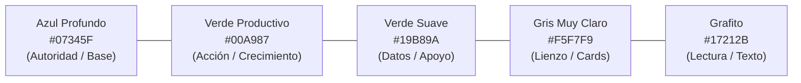
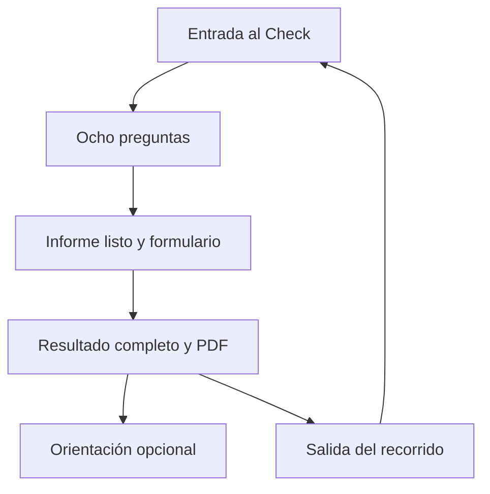

# Propuesta Visual y Design System v0.2
## Plataforma Digital · Método Productivo (Fase A y contrato de compras B)


> [!NOTE]
> Esta propuesta visual traduce las definiciones estratégicas de los documentos rectores del proyecto (**BRD v0.6**, **Arquitectura v0.5**, **Concepto y Alcance v0.8**, **Sitemap y Journeys v0.2** y **Propuesta de Marca v0.2**) en un sistema de diseño ejecutable, sobrio, contemporáneo y de alta conversión para PyMEs.

---

## 1. Fundamentos de Identidad y Marca

### 1.1 Posicionamiento Visual y Tono
La identidad se concibe como **ejecutiva, rigurosa, moderna y orientada a la acción**. Evita deliberadamente dos extremos comunes:
1. El cliché de "consultoría tradicional aburrida" (grises densos, estética corporativa genérica).
2. La estética "fintech neón / cripto" o el lenguaje de "gurú de negocios / *hustle culture*".

La marca proyecta **claridad, evidencia numérica y utilidad práctica inmediata** bajo el tagline:
> *"Productividad con sentido"*

---

### 1.2 Paleta Cromática y Tokens Oficiales

La combinación cromática se ancla en el contraste entre el **Azul Profundo** (autoridad institucional y solidez) y el **Verde Productivo** (progreso, dinamismo, resultados y crecimiento), con un fondo predominantemente claro para maximizar legibilidad y descanso cognitivo.



| Token / Color | Hex | RGB | Rol Funcional en la Interfaz | Regla de Uso |
| :--- | :--- | :--- | :--- | :--- |
| **Azul Profundo** | `#07345F` | `rgb(7, 52, 95)` | Encabezados principales, navegación superior, tarjetas institucionales, pie de página. | Color ancla. Da estructura y peso a la página sin saturar. |
| **Verde Productivo** | `#00A987` | `rgb(0, 169, 135)` | Botones de llamada a la acción primarios (CTA), barras de progreso completado, score destacado. | Reservado para acción, avance y resultado. Máximo un CTA primario por bloque. |
| **Verde Suave** | `#19B89A` | `rgb(25, 184, 154)` | Gráficas analíticas, chips de estado favorable, fondos de resaltado sutiles (`#E6F8F3`). | Elemento de apoyo para visualizar datos cuantitativos y tendencias. |
| **Gris Muy Claro** | `#F5F7F9` | `rgb(245, 247, 249)` | Fondo general del sitio, contenedores de sección, fondos de inputs secundarios y tablas. | Mantiene la ligereza visual; evita fondos oscuros extensos. |
| **Grafito** | `#17212B` | `rgb(23, 33, 43)` | Texto general de lectura, etiquetas de formulario, títulos secundarios. | Alto contraste WCAG AAA sobre blanco y gris claro. |
| **Borde / Divisor** | `#E2E8F0` | `rgb(226, 232, 240)` | Líneas divisorias, contornos de cards, bordes de inputs en reposo. | Delimitación limpia y sutil sin pesadez gráfica. |
| **Rojo Alerta** | `#DC2626` | `rgb(220, 38, 38)` | Mensajes de error en validaciones y rebotes de correo. | Restringido estrictamente a fallos reales; nunca con fines decorativos. |

---

### 1.3 Sistema Tipográfico

Se establece una jerarquía limpia combinando dos familias tipográficas de libre acceso y excelente rendimiento web:

1. **Titulares y Marca: Manrope (Bold 700 / ExtraBold 800)**
   - *Criterio:* Geométrica, moderna, con caracteres abiertos que comunican precisión y rigor analítico.
   - *Aplicación:* H1 de Hero, H2 de secciones, títulos de cuestionario y cards de valor.

2. **Cuerpo de Texto y UI: Inter (Regular 400 / Medium 500 / SemiBold 600)**
   - *Criterio:* Diseñada específicamente para interfaces en pantalla; legibilidad superior en párrafos largos, formularios y microcopy.
   - *Aplicación:* Párrafos explicativos, opciones de respuesta, etiquetas, avisos legales.

3. **Datos y Cifras Numéricas: Inter SemiBold con `tabular-nums`**
   - *Criterio:* Espaciado uniforme mono-numérico (`font-variant-numeric: tabular-nums`).
   - *Aplicación:* Calculadoras financieras, scores del Check PyME (0–100), porcentajes y tablas comparativas. Evita desalineaciones visuales en dashboards y cálculos en tiempo real.

```
Escala Tipográfica Modular:
• Display H1:  40px / Line-height: 1.15 / Manrope 800
• Section H2:  28px / Line-height: 1.25 / Manrope 700
• Title H3:    20px / Line-height: 1.30 / Manrope 600
• Body Large:  17px / Line-height: 1.60 / Inter 400
• Body Base:   15px / Line-height: 1.55 / Inter 400
• UI Small:    13px / Line-height: 1.40 / Inter 500
• Caption:     11.5px / Line-height: 1.30 / Inter 600 (uppercase)
```

---

### 1.4 Ejes Editoriales ("Submarcas")

Las cuatro submarcas operan como categorías editoriales y de producto dentro del mismo portal, cada una identificada por un código visual coherente:

1. **Finanzas con Método** (Acabado en Azul Profundo `#07345F`):
   *Crédito PyME, evaluación de proyectos, flujos de caja y estados financieros.*
2. **Negocios con Método** (Acabado en Verde Productivo `#00A987`):
   *Margen, costos operativos, estrategia de precios y formalización de procesos.*
3. **Datos con Método** (Acabado en Azul Petróleo / Teal `#0E7490`):
   *Modelos en Excel y Python, indicadores clave (KPIs), analítica aplicada.*
4. **Tecnología con Método** (Acabado en Pizarra `#475569`):
   *Automatización de procesos, herramientas digitales e Inteligencia Artificial práctica.*

---

## 2. Principios de Experiencia de Usuario (UX)

> [!IMPORTANT]
> Los siguientes cuatro principios son de observancia estricta en el diseño e implementación de la Fase A:

1. **Informe listo y captura**:
   - Calculadora pública sin datos personales.
   - Check: ocho preguntas y aviso **“Tu informe está listo”**. Antes del formulario no se muestran score, nivel, fortalezas ni brechas.
   - Capturar nombre, correo y empresa obligatorios; teléfono WhatsApp opcional. Consentimientos de servicio y comercial separados.
   - Tras envío válido mostrar resultado completo y **“Descargar PDF”**, sin correo de acceso ni magic link.

2. **Sin cuentas y accesos por propósito**:
   - Check: reintentar PDF en la misma pantalla; después de salir requiere nuevo cuestionario y captura. No existe recuperación.
   - Compras digitales B: Stripe Checkout captura correo; webhook válido confirma pago; correo con magic link. Acceso 14 días desde pago y hasta tres descargas exitosas.
   - GET y fallos no consumen descargas. Reemitir no reinicia límites. Lead magnets y otros propósitos conservan sus reglas propias.

3. **Móvil primero con densidad óptima**:
   - El cuestionario del Check PyME presenta **una sola pregunta por pantalla en móvil**.
   - Tarjetas de opción con superficie táctil generosa (altura mínima de 52px) y espaciado de seguridad.
   - Cero pop-ups o modales invasivos que tapen el flujo de avance.

4. **Un solo CTA primario por bloque**:
   - Cada pantalla y cada sección tiene un objetivo principal no ambiguo (ej. "Hacer Check PyME" o "Abrir Calculadora"). Los botones secundarios utilizan estilo *outline* o enlace de texto.

---

## 3. Especificación Visual de Pantallas Clave (Fase A y contrato de compras B)



La flecha de salida a inicio exige un cuestionario nuevo; no recupera el anterior. Nombre, correo y empresa obligatorios; WhatsApp opcional.


---

### Pantalla 1: Home Portal (`/`)
* **Barra de Anuncio Superior:** Cinta delgada azul marino informando la disponibilidad gratuita del Check PyME v1.3.
* **Header / Navegación:** Logotipo oficial de Método Productivo a la izquierda, enlaces a Check PyME, Herramientas, Blog y Contacto al centro, y botón primario verde *"Hacer Check PyME →"* a la derecha.
* **Hero Split:**
  - *Columna Izquierda:* Badge de confianza *"Herramienta gratuita para PyMEs · 3 min"*, H1 contundente *"Decisiones financieras y empresariales con método, claridad y datos"*, párrafo de soporte, botones duales (Primario Verde: *"Evaluar mi PyME gratis"*, Secundario Blanco: *"Ver calculadora"*) y lista de 3 checks de baja fricción (Sin cuentas, resultado inmediato, basado en datos).
  - *Columna Derecha (Hero Card Showcase):* Tarjeta flotante interactiva que muestra una vista previa del velocímetro de score (ejemplo ilustrativo 69/100 · Gestión en desarrollo) y 3 barras de avance de dimensiones, transmitiendo visualmente qué recibirá el visitante.
* **Bloque de Submarcas Editoriales:** Grid de 4 tarjetas con bordes superiores identificadores en cada disciplina.
* **Bloque Dual de Conversión:**
  - *Tarjeta Izquierda:* Calculadora inicial por aprobar; punto de equilibrio es una propuesta.
  - *Tarjeta Derecha:* Lead magnet por aprobar; plantilla de flujo de efectivo a 13 semanas es una propuesta. Mantener su captura y consentimiento propios.
* **Bloque Multimedia:** Reproductor de video integrado para la serie en YouTube y listado de 2 artículos clave de finanzas y datos.
* **Footer Institucional:** Enlaces legales, categorías sin enlace de recuperación del diagnóstico. La recuperación de compras se agrega en B.

---

### Pantalla 2: Check PyME · Cuestionario (`/check-pyme/diagnostico/`)
* **Header de Diagnóstico:** Logotipo, indicador de versión *v1.3* y botón discreto para salir o reiniciar.
* **Barra de Progreso Continua:** Indicador de avance superior (ej. *"Pregunta 3 de 8 · 38% completado"*) con barra de relleno verde suave.
* **Tarjeta de Pregunta Activa:**
  - *Etiqueta superior:* Nombre de la dimensión (ej. *"Dimensión 3: Concentración de clientes"*).
  - *Enunciado H2:* Tipografía Manrope de 22px con interlineado cómodo.
  - *Microtexto de orientación:* Breve explicación del porqué importa este indicador para el negocio.
  - *Tarjetas de Respuesta (Radio Cards):* 3 a 5 tarjetas con borde gris de 1.5px, radio de selección circular y cambio de estado a verde esmeralda con fondo `#E6F8F3` al seleccionarse.
* **Botonera Inferior:** Botón *"← Anterior"* (oculto en la primera pregunta) y botón primario verde *"Siguiente →"*. En la última pregunta, el botón se transforma en *"Preparar mi informe →"*.

---

### Pantalla 3 Informe listo y captura (`/check-pyme/resultado/`)

- Antes del formulario: **“Tu informe está listo”**. No mostrar score ni hallazgos.
- Campos obligatorios: **Nombre**, **Correo electrónico**, **Nombre de la empresa**.
- Campo opcional: **Teléfono WhatsApp**, con indicación visible de que es opcional.
- Consentimiento de servicio conforme al aviso y consentimiento comercial opcional separados; WhatsApp no suscribe a publicidad.
- Botón: **“Ver mi resultado y descargar PDF”**.
- Error de validación junto al campo, conservando respuestas y otros campos.
- Al enviar, persistir captura y diagnóstico; no requerir abrir correo.

### Pantalla 3B Resultado completo en el mismo recorrido

- Score y nivel; desglose; **hasta dos fortalezas y hasta dos brechas**; tres acciones del catálogo v0.1 aprobado; disclaimer.
- Botón **“Descargar PDF”** y reintento si ocurre error técnico.
- **“Solicitar orientación”** despliega una acción en la misma pantalla usando los datos capturados.
- Mensaje: **“Descarga tu informe antes de salir. Para obtener otro, deberás realizar el Check nuevamente.”**
- No mostrar historial, búsqueda por correo ni recuperación de informes.
- Retención interna de contacto, respuestas y resultado: 12 meses; no equivale a acceso público.

### Compra digital Fase B

- Producto con descripción, precio, condiciones y **“Comprar”**.
- Stripe Checkout captura el correo; no solicita crear cuenta en el portal.
- Pago confirmado por webhook: enviar magic link al correo asociado a la orden.
- Página intermedia: **“Descargar archivo”**, vencimiento y descargas restantes.
- **14 días desde pago y hasta tres descargas exitosas**. Abrir/confirmar sin descargar y errores no descuentan.
- Reemisión conserva límites; excepciones por soporte con registro.

### Pantalla 4: Propuesta de calculadora de Punto de Equilibrio (`/herramientas/punto-de-equilibrio/`)
* **Estructura Split:**
  - *Columna de Entradas:* 3 sliders interactivos con campo numérico editable: Costos fijos mensuales ($), Precio unitario ($), y Costo variable unitario ($).
  - *Columna de Salidas:* 4 tarjetas KPI en tiempo real:
    1. Punto de equilibrio en unidades (ej. `137 u. / mes`).
    2. Ingresos de equilibrio (ej. `$164,400 MXN`).
    3. Margen de contribución monetario (ej. `$550 MXN / unidad`).
    4. Margen de contribución porcentual (ej. `45.8%`).
* **Gráfica Dinámica SVG:** Visualización de líneas de Ingresos Totales (Verde Productivo) vs Costos Totales (Azul Profundo), destacando el punto de intersección con etiqueta visible.
* **Banner de Siguiente Paso:** Conector visual que invita a realizar el Check PyME para evaluar la estructura integral de costos y ventas.

---

## 4. Componentes Base del Design System v0.2

### 4.1 Botones (Buttons)
```css
/* Botón Primario: Acción y Conversión */
.btn-primary {
  background-color: #00A987;
  color: #17212B;
  font-family: 'Inter', sans-serif;
  font-weight: 600;
  border-radius: 10px;
  padding: 12px 24px;
  box-shadow: 0 4px 12px rgba(0, 169, 135, 0.25);
  transition: all 0.2s ease;
}
.btn-primary:hover {
  background-color: #008f72;
  transform: translateY(-1px);
}

/* Botón Secundario: Alternativa sin ruido */
.btn-secondary {
  background-color: #FFFFFF;
  color: #07345F;
  border: 1.5px solid #E2E8F0;
  border-radius: 10px;
  padding: 12px 24px;
}
.btn-secondary:hover {
  border-color: #07345F;
  background-color: #F8FAFC;
}
```

### 4.2 Radios y Sombras (Elevation)
- **Radio de botones e inputs:** `10px` (moderno, amigable pero sobrio).
- **Radio de tarjetas y contenedores:** `16px`.
- **Radio de badges y píldoras:** `9999px` (full pill).
- **Elevación ligera (`--shadow-sm`):** `0 1px 3px rgba(7, 52, 95, 0.04)`.
- **Elevación destacada (`--shadow-md`):** `0 4px 14px rgba(7, 52, 95, 0.08)`.
- **Elevación de modales / hero (`--shadow-lg`):** `0 12px 30px -4px rgba(7, 52, 95, 0.12)`.

---

## 5 Estado del prototipo y activos

El HTML referido en v0.1 no forma parte de estos adjuntos y no se modifica en esta actualización. Su navegación, textos y simulaciones deben homologarse con v0.2 antes de considerarlo evidencia de cumplimiento. La ruta local al logo requiere incluir el activo en el paquete del proyecto; no se afirma que sea accesible fuera del equipo original.

Calculadora y lead magnet siguen siendo propuestas hasta aprobar sus especificaciones. No se exige reporte de 12 páginas. Verificar teclado, foco, semántica, mensajes y contraste de todos los componentes; el CSS de botón usa grafito sobre verde para evitar la combinación de texto normal blanco sobre #00A987.

## 6 Control de cambios

v0.2 del 13 de octubre de 2026: flujos y campos aprobados del Check; sin resultado previo ni magic link del diagnóstico; compras con correo de Checkout, 14 días y tres descargas exitosas; navegación alineada; hasta dos hallazgos; reintentos, orientación y retención interna. Identidad y categorías editoriales conservadas.
